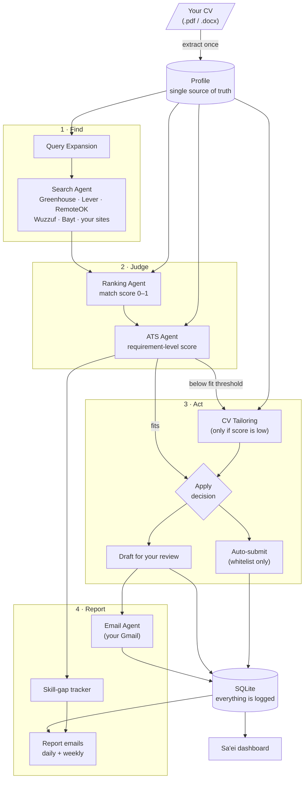
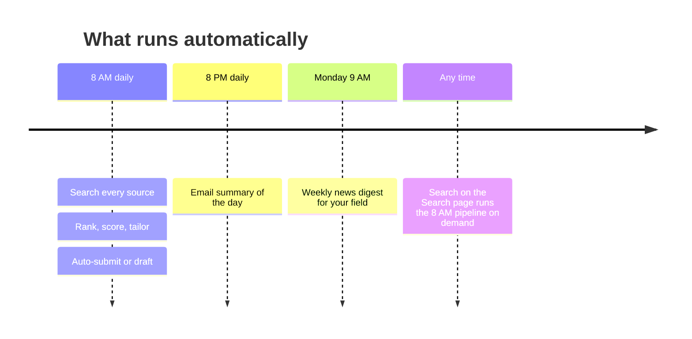
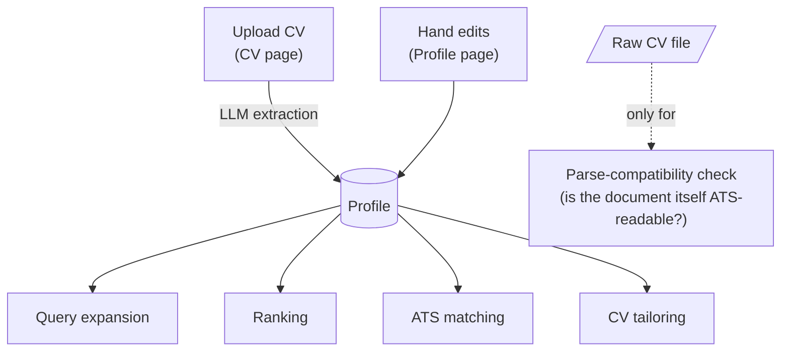
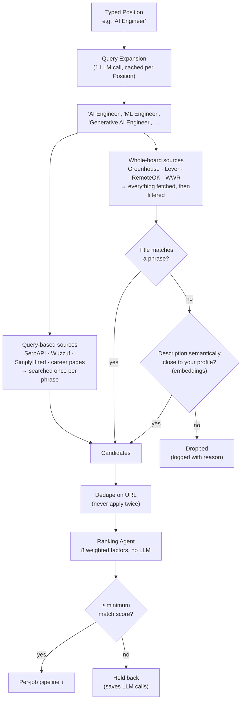
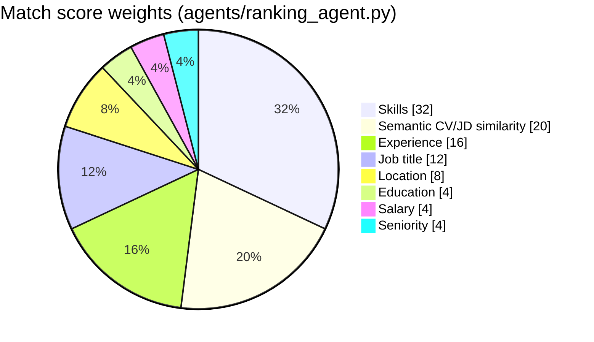
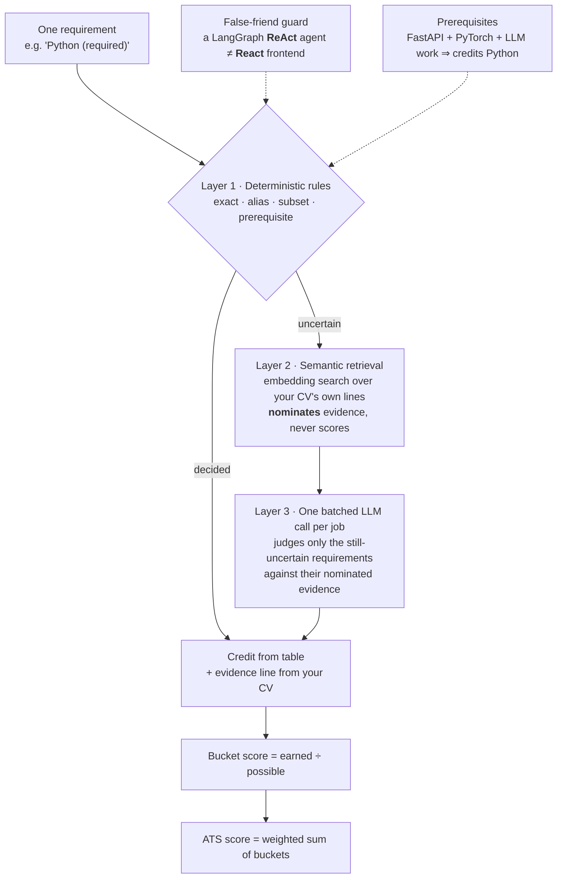
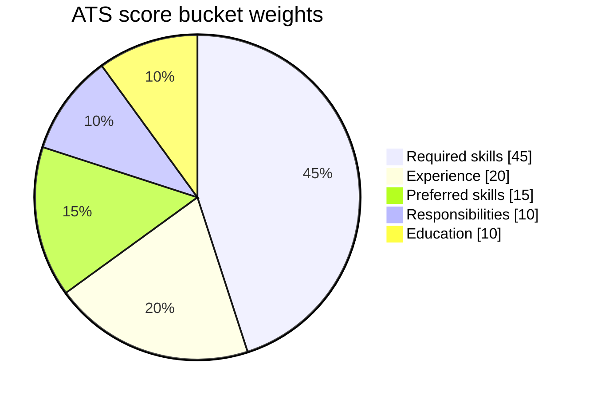
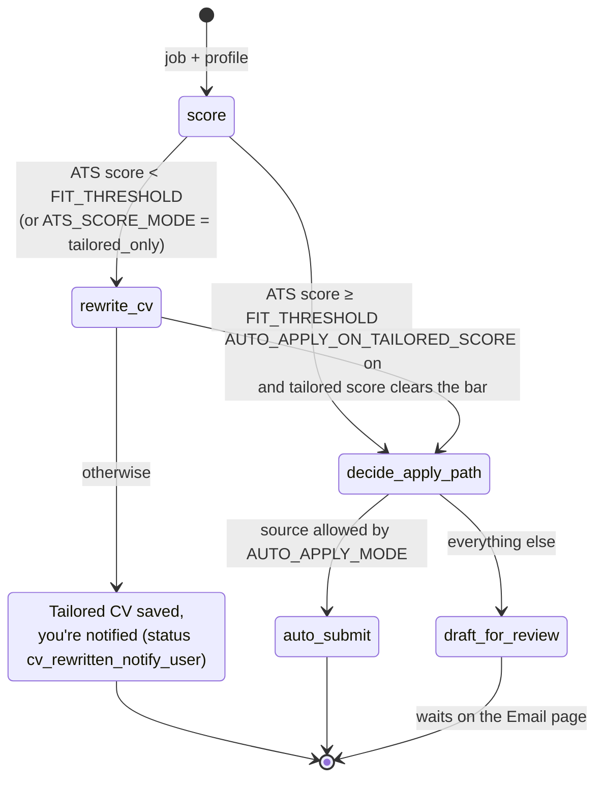
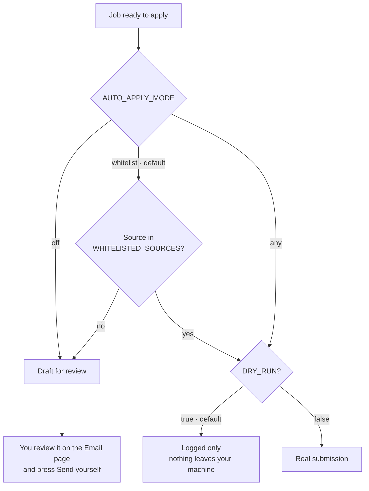
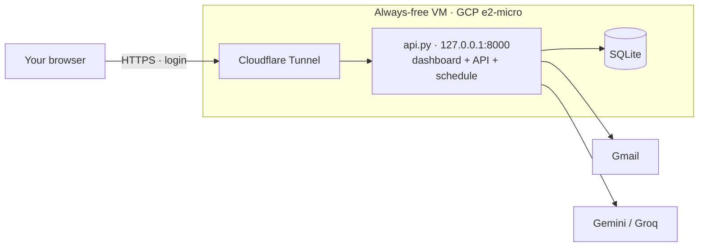

<p align="center">
  
</p>

<h1 align="center">Sa'ei · ساعي</h1>
<p align="center"><em>Your AI career companion. It searches, matches and tailors for you, and applies only where you allow it.</em></p>

---

## The idea

Job hunting is mostly repetitive work. You check the same boards every day,
read postings to decide whether they fit, rewrite your CV for each one, fill
in forms, and track what you sent where. **Sa'ei** (Arabic *ساعي*, "the one
who strives", also "the messenger") is a set of AI agents that does that work
for you every day. Three rules shape how it behaves:

1. **It never makes things up.** Your CV becomes one structured *profile*,
   and that profile is the only thing any agent reads. A tailored CV
   rephrases your real experience in the posting's own words. It never adds
   skills you don't have; missing skills are reported as gaps instead.
2. **Every score can be explained.** A match score or ATS score is never a
   number the model made up. It's computed in Python from evidence, and every
   point traces back to a specific line of your CV.
3. **You decide what gets sent.** By default nothing is sent at all (dry
   run). When sending is on, the agent submits automatically only on job
   boards you've explicitly whitelisted. Everything else is prepared as a
   complete draft and waits for your approval.

Everything runs on free tools: local or free-tier AI models, public job-board
APIs, and your own Gmail.

---

## How it works at a glance



A day in the life (all times are local, from `scheduler.py`):



---

## Core concepts

### 1. Your profile is the single record of you

Uploading a CV extracts a structured profile (contact, summary, experience,
projects, education, certifications, skills). **Every stage reads the
profile, not the file**, so a correction you make on the Profile page
reaches search, ranking, scoring and tailoring the next time they run.



> ⚠️ Uploading a new CV **replaces** the profile, including your hand edits.
> To pick up changes from the file without losing edits, use
> **Profile → Re-extract from CV**, which previews what would change first.

### 2. Finding jobs: search wide, then rank carefully

Job boards describe the same role in a dozen different ways, so finding jobs
is split into two stages tuned in opposite directions. **Retrieval** favours
recall (don't miss anything plausible). **Ranking** favours precision (put
the best fits first).



The **semantic path** is what catches a "Backend Developer" posting during a
"Software Engineer" search when the content genuinely fits you. Only jobs the
title filter rejects are embedded; a job it already accepted isn't paid for
twice.

**The match score** answers *"is this job right for me?"*. It's a weighted
sum of eight factors. Ranking deliberately uses no LLM, so ordinary search
volume never uses up a free-tier quota.



When a posting doesn't state something (salary and location often aren't
listed), that factor scores **neutral, not zero**. A job isn't penalised for
how its source happens to format postings.

### 3. The ATS score: requirement by requirement, fully explained

The ATS score answers a different question: *"would my CV get through this
employer's screening?"* Rather than counting keywords, the ATS agent
(`agents/ats_agent.py`):

1. extracts every requirement from the posting (one LLM call),
2. matches each requirement against your profile in up to three layers,
   stopping as soon as one layer decides,
3. computes the final score **in Python** from a credit table. No number a
   model returns ever reaches the score.



How the final number is weighted (`config.JOB_MATCH_WEIGHTS`):



Buckets a posting doesn't mention (no education line, say) are left out, and
their weight is spread over the rest. Inside a bucket, a *required* skill is
worth more points than a *preferred* one. Separately, a **parse-compatibility
check** (headers, length, bullet consistency, sections) grades the CV
*document* Pass / Warning / Fail, since that's a property of the file, not of
any one job.

Every **Why?** button in the dashboard opens this breakdown: each
requirement, how it matched (exact / alias / prerequisite / semantic / not
found), the points it earned, and the CV line that proves it. It's built from
the scoring pass itself, so explaining a score costs no extra LLM call.

Details: [MATCHING.md](MATCHING.md) (the matcher) and
[SCORING.md](SCORING.md) (the scoring pipeline, with a worked example).

### 4. What happens to each job

Every job that passes the match gate goes through a small LangGraph state
machine (`orchestrator.py`):



The tailored CV is scored again against the same requirements, which costs
one extra call rather than two. You see both numbers side by side, so you can
check how much the tailoring actually helped.

### 5. Who is allowed to press "send"



---

## The dashboard

`frontend/` is a static site, served by the API itself at `/` (or open it
from any static server). It talks to the FastAPI backend in `api.py`, and its design comes from the
**Sa'ei** project in Stitch.

| Page | What it's for |
|---|---|
| **Home** | Greeting, the five-stage trajectory (Search → Match → Tailor → Apply → Grow), headline numbers, recent applications, and the skill gap Sa'ei noticed most |
| **Search** | Role, experience level and freshness; the job boards to scan (*Manage sources*); *Search* runs the pipeline now; the best recent matches |
| **Applications** | Every application, filterable, with a detail panel: match affinity, the factors behind it, ATS evidence — and **Submit Application**, which sends the email from your Gmail |
| **CV** | Master CV (view, download, replace), every tailored CV with its before → after ATS score, and the **ATS & tailoring bench**: paste a job description and see the score and rewrite without saving anything |
| **Profile** | The extracted profile every agent reads, in sections that open one at a time; reorder them (tailored CVs follow the order) or add your own |
| **Reports** | Headline numbers, a plain-language momentum summary, skill-gap bars, where roles come from, the latest news digest, and every dispatch (report emails and application emails) |
| **Settings** | AI provider and keys, autonomy mode, ATS and match thresholds, advanced matching, and notification channels (Gmail sign-in, where reports are emailed; Gmail connection) |

Styling uses Tailwind, shipped **pre-compiled** as `frontend/tailwind.css`,
and fonts are stored in the repo, so the dashboard needs no CDN and no build
step to run. Only after you change Tailwind classes, rebuild from
`frontend/`:

```bash
npx tailwindcss@3 -c tailwind.config.js -i tailwind.src.css -o tailwind.css --minify
```

The dashboard is desktop-only (minimum width 1100px).

---

## Getting started

**Quickest:** on macOS or Linux run `./run.sh`; on Windows double-click
`run.bat`. On first run, either one sets everything up (virtual environment,
packages, `.env`) and then opens the dashboard at http://localhost:8001/.
You need Python 3.10+ (3.11+ recommended) and one language model (step 2).
The steps below are the same thing done by hand.

### 1. Install

```bash
# venv
python -m venv .venv && .venv\Scripts\activate      # source .venv/bin/activate on macOS/Linux
pip install -r requirements.txt

# …or conda
conda env create -f environment.yml && conda activate job-agent
```

```bash
cp .env.example .env     # then fill in what you plan to use
```

With only that, it already runs in dry-run mode: Greenhouse and Lever need
no key, and `DRY_RUN=true` is the default.

### 2. Pick a language model (any one, all free)

| Provider | Setup | Good to know |
|---|---|---|
| **Ollama** (local) | `ollama pull qwen3:4b` | Unmetered and private. A non-thinking instruct model (e.g. `qwen2.5:7b-instruct`) avoids reasoning leaking into output. |
| **Gemini** | `GEMINI_API_KEY` | Free tier; the same key can also do embeddings. |
| **Groq** | `GROQ_API_KEY` | Fastest hosted option. Capped at **200k tokens/day**. |
| **OpenRouter** | `OPENROUTER_API_KEY` | ~400 models. `:free` ids are capped at **50 requests/day** (~15–20 jobs). |

For semantic matching, also run `ollama pull nomic-embed-text` (or
`qwen3-embedding:4b` for Arabic and mixed-language postings). Without an
embedding model it still works; it just loses the semantic path's extra
recall. Everything here can also be changed on the **Settings** page.

### 3. Add your CV, then run

Upload your CV on the **CV** page (or drop it at `cv/current_cv.pdf`).

| | Command |
|---|---|
| **Windows, one click** | `run.bat` (venv) or `run_conda_quick.bat` (conda). Starts the API and scheduler and opens the dashboard. |
| **macOS / Linux** | `./run.sh`. Starts the dashboard, API and schedule in one process and opens the browser. |
| Run the pipeline once | `python jobs/daily_run.py` |
| Apply from one link | `python jobs/apply_from_link.py "https://boards.greenhouse.io/acme/jobs/123"` |
| Always-on scheduler | `python scheduler.py` |
| API + dashboard | `uvicorn api:app --port 8001`, then open http://localhost:8001/ |

Everything runs on your machine, so it stops when your machine sleeps. See
[Deployment](#deployment) to keep it running unattended.

### Job boards for your region

A new install searches the remote-job feeds and the Greenhouse/Lever boards
in `.env`. The job boards below are listed under **Search → Manage
sources**, dimmed, each with an **Add** button; nothing is searched until
you add it, and a removed board goes back to the list. To have some added on
first run instead, list their keys in `SEARCH_DEFAULT_BOARDS`.

| Key | Board | Covers |
|---|---|---|
| `wellfound` | wellfound.com | Startups, worldwide |
| `simplyhired` | simplyhired.com | Worldwide |
| `wuzzuf` | wuzzuf.net | Egypt |
| `tanqeeb` | egypt.tanqeeb.com | Egypt |
| `bayt` | bayt.com | Gulf / MENA |
| `gulftalent` | gulftalent.com | Gulf |

Any other careers page can be pasted too; it's read on a best-effort basis.

### Connect Gmail (optional)

Gmail sends the applications you approve, plus your daily report and weekly
news. In **Settings → Notifications & Channels**, click **Sign in with
Google**: Google's own account chooser opens in a new tab; pick your account
and allow Sa'ei to send email. Sa'ei can only send, not read your inbox. It
uses Sa'ei's shared Google app, so there's nothing to set up (see
[docs/google-sign-in.md](docs/google-sign-in.md)).

Reports go to your own address unless you set another under *Send reports to*.
While `DRY_RUN=true`, nothing is sent; reports are only logged on the Reports page.

---

## Enabling auto-submit

Auto-submit is meant to be verified **one employer at a time**, not switched
on everywhere at once:

1. Inspect that board's application form. Every Greenhouse/Lever board can
   have its own custom fields.
2. Implement its payload in `agents/apply_agent.py::auto_submit_greenhouse`.
   This is currently a deliberate stub.
3. Test with `DRY_RUN=true`, then on one real application with
   `DRY_RUN=false`.
4. Add `"greenhouse:<board_token>"` or `"lever:<company_slug>"` to
   `WHITELISTED_SOURCES`.

Related settings (Settings → *Auto-apply* and *ATS & tailoring*):
`AUTO_APPLY_MODE` (`off` / `whitelist` / `any`), `FIT_THRESHOLD` (default
70%, below which the CV gets tailored), and `AUTO_APPLY_ON_TAILORED_SCORE`
(off by default, because a higher score doesn't prove the rewrite overstated
nothing).

---

## Deployment

One small always-on server runs everything: the API, the dashboard (the API
serves `frontend/` itself at `/`) and the daily schedule (inside the API
process with `RUN_SCHEDULER_IN_API=true`). It's a real, persistent Python
process (SQLite, LangGraph, APScheduler), so serverless runtimes such as
Vercel functions or Cloudflare Workers can't run it.



**What changes on a server** (all set by `deploy/gcp/startup-script.sh`):

| Setting | Why |
|---|---|
| `APP_PASSWORD` | The dashboard asks for a login. Generated on first boot if blank. |
| `RUN_SCHEDULER_IN_API=true` | One process instead of two on a 1 GB machine. |
| `SCHEDULER_TIMEZONE=Africa/Cairo` | The VM clock is UTC. |
| `LLM_PROVIDER`, `EMBEDDING_PROVIDER` → `gemini` if they were `ollama` | 1 GB of RAM can't run Ollama. Groq/OpenRouter are kept if you chose them. |
| `GMAIL_INTERACTIVE_AUTH=false` | No browser on a server. Connect Gmail on your PC; the token is copied over. |

**Google Cloud, free tier** (scripts in `deploy/gcp/`):

1. Create the VM (Debian 12, the startup script installs and starts everything):
   ```bash
   gcloud compute instances create saei --zone=us-central1-a --machine-type=e2-micro --image-family=debian-12 --image-project=debian-cloud --boot-disk-size=30GB --boot-disk-type=pd-standard --metadata-from-file=startup-script=deploy/gcp/startup-script.sh
   ```
2. Copy your data and keys over (database, CV, tailored CVs, Gmail token, `.env`):
   ```bash
   powershell -ExecutionPolicy Bypass -File deploy\gcp\push-data.ps1 -IncludeEnv
   ```
   It prints the command that shows your dashboard login.
3. Give it an HTTPS address: install `cloudflared` on the VM and fill in
   `deploy/gcp/cloudflared/config.yml.example` (needs a domain on Cloudflare).
   Without a domain, `cloudflared tunnel --url http://localhost:8000` gives a
   temporary `trycloudflare.com` address for testing.
4. Open the address and sign in.

To update after pushing to GitHub: `gcloud compute instances reset saei --zone=us-central1-a`
(the startup script pulls `main` on every boot). Logs:
`gcloud compute ssh saei --zone=us-central1-a --command "journalctl -u job-agent-api -n 100"`.

**Gmail on a server:** while the OAuth consent screen in Google Cloud is in
*Testing*, Google expires the sign-in after 7 days and sending stops. Set it
to *In production* (no review needed for your own account) so it lasts.

---

## Project layout

```
config.py / .env        settings (the Settings page writes .env via env_store.py)
models.py / db.py       SQLite schema + sessions
cv_parser.py            PDF/DOCX → text
profile_store.py        the stored profile every stage reads
orchestrator.py         LangGraph state machine for one job
scheduler.py            08:00 search · 20:00 report · Mon 09:00 news
api.py                  FastAPI backend for the dashboard
agents/                 search · query_expansion · ranking · ats · cv_rewriter/render/targeting
                        apply · email · reporter · news · skill_gap
                        + matcher internals: skill_matching, semantic_matching,
                          evidence_retrieval, requirement_normalizer, embeddings, llm
services/               embedding cache + per-CV semantic index
jobs/                   entry points: daily_run, daily_report, weekly_news, apply_from_link
frontend/               the Sa'ei dashboard (7 pages + shell.js, ui.js, config.js)
bench/                  labelled matching cases, precision/recall + calibration
tests/                  pytest suite
deploy/gcp/             VM startup script, systemd unit, data upload script, cloudflared config
ARCHITECTURE.md         file-by-file technical deep-dive
MATCHING.md             how a CV is matched against a job description
SCORING.md              the ATS scoring pipeline, with a worked example
```

## Testing

```bash
pytest                              # whole app: whitelist enforcement, dedup, profile-first pipeline, matcher layers…
python -m bench.report              # matcher precision/recall + score regression
python -m bench.report --calibrate  # re-derive semantic thresholds after changing embedding model
```

## Tech stack (all free)

| Layer | Tools |
|---|---|
| Orchestration | LangGraph, APScheduler |
| LLM | Ollama · Gemini · Groq · OpenRouter |
| Embeddings | Ollama `nomic-embed-text` / `qwen3-embedding:4b` · Gemini `gemini-embedding-001` |
| Job sources | Greenhouse & Lever APIs, RemoteOK, We Work Remotely, SerpAPI (optional), Google Sheets watchlist, scraped career pages |
| Documents | `pdfplumber`, `python-docx`, `reportlab` |
| Delivery | Gmail API, through Sign in with Google (OAuth) |
| Storage / API | SQLite + SQLAlchemy, FastAPI |
| Frontend | Static HTML/JS + pre-compiled Tailwind |

## Cautions

- **Respect each board's Terms of Service.** Use public APIs or sites that
  allow access. Indeed blocks automated requests and is not supported;
  LinkedIn is read only through its public, logged-out job search, paced by
  `LINKEDIN_REQUEST_DELAY`.
- **Rate-limit yourself.** Too many automated requests can get an IP or
  account flagged.
- **Scale auto-submit slowly.** Start with drafts everywhere, then whitelist
  one board at a time.
- **Scores from before 2026-08-26 aren't comparable.** They came from the
  retired four-pillar engine. Recalibrate `FIT_THRESHOLD` from real runs.

## License

[MIT](LICENSE). Use it, learn from it, change it. It's provided as-is: you're
responsible for what it sends in your name and for following each job
board's terms.
