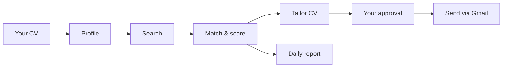

  

<h1 align="center">Sa'ei · ساعي</h1>

<em>An AI career companion that finds jobs, matches them to your CV, tailors it, and applies only where you allow.</em>

---

Job hunting is repetitive: checking boards, reading postings, rewriting your
CV, sending applications. **Sa'ei** (Arabic for "the one who strives") is a
set of AI agents that does this for you every day, on your own computer.

## What it does

- **Finds jobs** on LinkedIn, Greenhouse, Lever, Wuzzuf, Bayt and more, every morning.
- **Scores each role** against your CV, and explains every point of the score.
- **Tailors your CV** to a role in the posting's own words, without inventing anything.
- **Prepares applications** and emails them from your Gmail when you approve.
- **Reports back** with a daily summary email and a weekly news digest for your field.

## How it behaves

1. **It never makes things up.** Tailored CVs only reword your real experience.
2. **Every score is explained.** Each point traces back to a line of your CV.
3. **You decide what's sent.** By default nothing leaves your machine.

## Get started

On Windows, double-click `run.bat`. On macOS or Linux, run `./run.sh`. The
dashboard opens at http://localhost:8001/.

**Full setup guide: [docs/setup.md](docs/setup.md)**

## Documentation

| Guide | What's in it |
|---|---|
| [Setup](docs/setup.md) | Install, choose an AI model, add your CV, connect Gmail |
| [How it works](docs/how-it-works.md) | The pipeline, scores and dashboard, with diagrams |
| [Deployment](docs/deployment.md) | Keep it running on an always-on server |
| [Architecture](docs/architecture.md) | File-by-file technical deep dive |
| [Matching](docs/matching.md) | How a CV is matched against a job description |
| [Scoring](docs/scoring.md) | The ATS scoring pipeline, with a worked example |
| [Google sign-in](docs/google-sign-in.md) | How Gmail sending is set up |

## Built with

Python · FastAPI · LangGraph · SQLite · Tailwind. AI models: Ollama (local),
Groq, Gemini, OpenRouter, Anthropic or OpenAI.

## License

[MIT](LICENSE). You're responsible for what it sends in your name and for
following each job board's terms.
