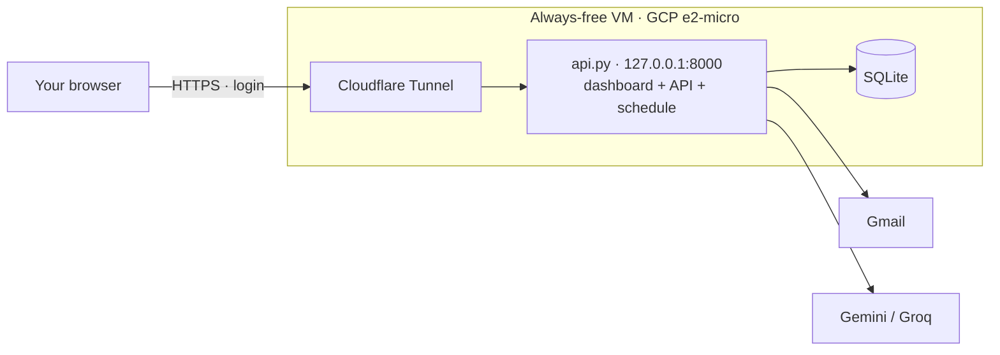

# Running Sa'ei on a server

On your PC, Sa'ei stops when the computer sleeps. To keep it running every
day, put it on a small always-on server. This is optional; see
[setup.md](setup.md) for running it locally.

One small always-on server runs everything: the API, the dashboard (the API
serves `frontend/` itself at `/`) and the daily schedule (inside the API
process with `RUN_SCHEDULER_IN_API=true`). It's a real, persistent Python
process (SQLite, LangGraph, APScheduler), so serverless runtimes such as
Vercel functions or Cloudflare Workers can't run it.



**What changes on a server** (all set by `deploy/gcp/startup-script.sh`):

| Setting | Why |
|---|---|
| `APP_PASSWORD` | The dashboard asks for a login. Generated on first boot if blank. |
| `RUN_SCHEDULER_IN_API=true` | One process instead of two on a 1 GB machine. |
| `SCHEDULER_TIMEZONE=Africa/Cairo` | The VM clock is UTC. |
| `LLM_PROVIDER`, `EMBEDDING_PROVIDER` → `gemini` if they were `ollama` | 1 GB of RAM can't run Ollama. Groq/OpenRouter are kept if you chose them. |
| `GMAIL_INTERACTIVE_AUTH=false` | No browser on a server. Connect Gmail on your PC; the token is copied over. |

**Google Cloud, free tier** (scripts in `deploy/gcp/`):

1. Create the VM (Debian 12, the startup script installs and starts everything):
   ```bash
   gcloud compute instances create saei --zone=us-central1-a --machine-type=e2-micro --image-family=debian-12 --image-project=debian-cloud --boot-disk-size=30GB --boot-disk-type=pd-standard --metadata-from-file=startup-script=deploy/gcp/startup-script.sh
   ```
2. Copy your data and keys over (database, CV, tailored CVs, Gmail token, `.env`):
   ```bash
   powershell -ExecutionPolicy Bypass -File deploy\gcp\push-data.ps1 -IncludeEnv
   ```
   It prints the command that shows your dashboard login.
3. Give it an HTTPS address: install `cloudflared` on the VM and fill in
   `deploy/gcp/cloudflared/config.yml.example` (needs a domain on Cloudflare).
   Without a domain, `cloudflared tunnel --url http://localhost:8000` gives a
   temporary `trycloudflare.com` address for testing.
4. Open the address and sign in.

To update after pushing to GitHub: `gcloud compute instances reset saei --zone=us-central1-a`
(the startup script pulls `main` on every boot). Logs:
`gcloud compute ssh saei --zone=us-central1-a --command "journalctl -u job-agent-api -n 100"`.

**Gmail on a server:** while the OAuth consent screen in Google Cloud is in
*Testing*, Google expires the sign-in after 7 days and sending stops. Set it
to *In production* (no review needed for your own account) so it lasts.
