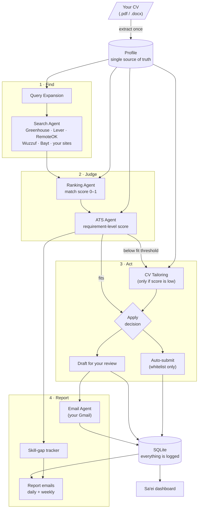
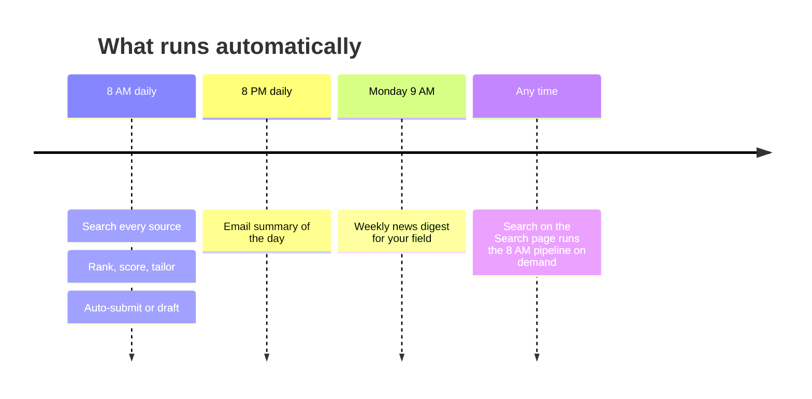
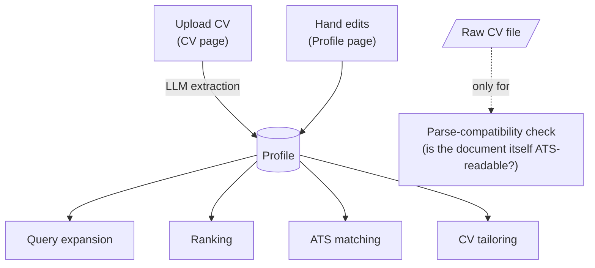
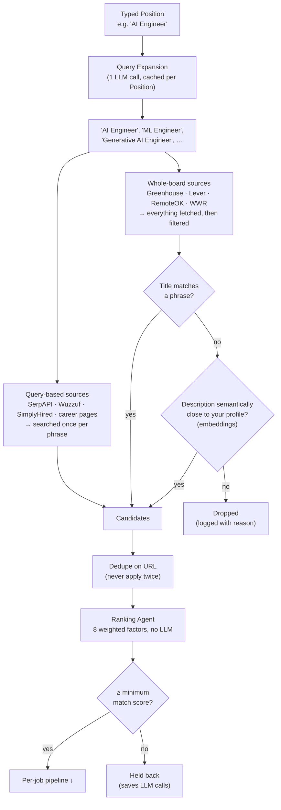
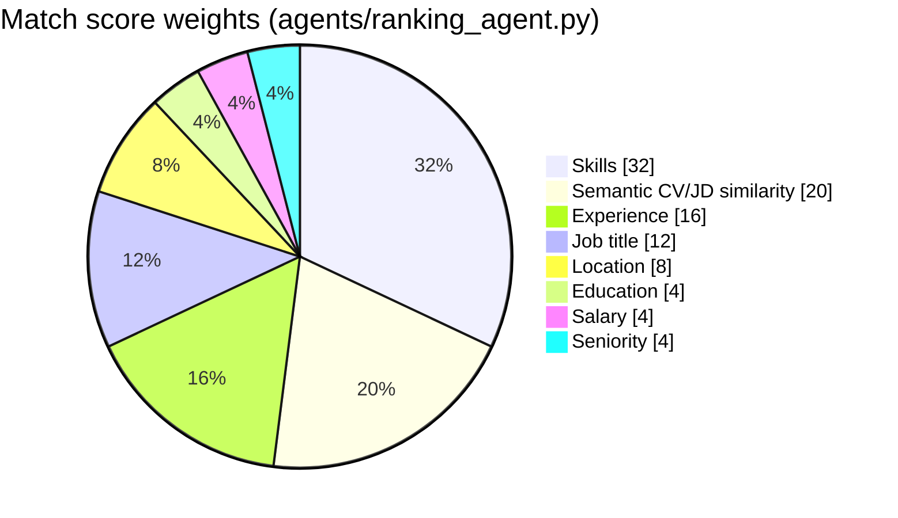
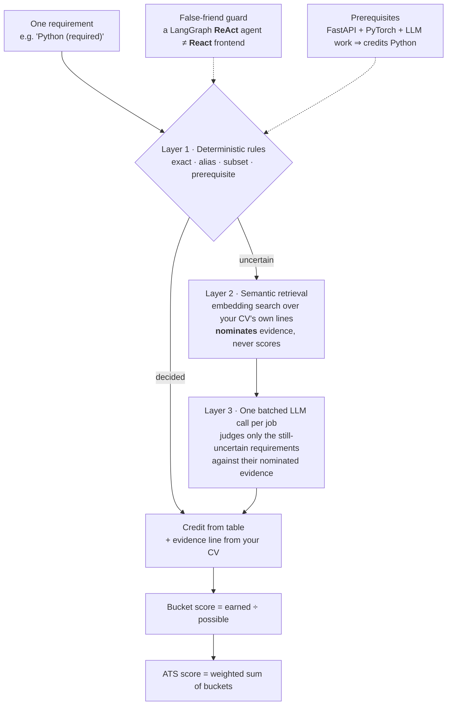
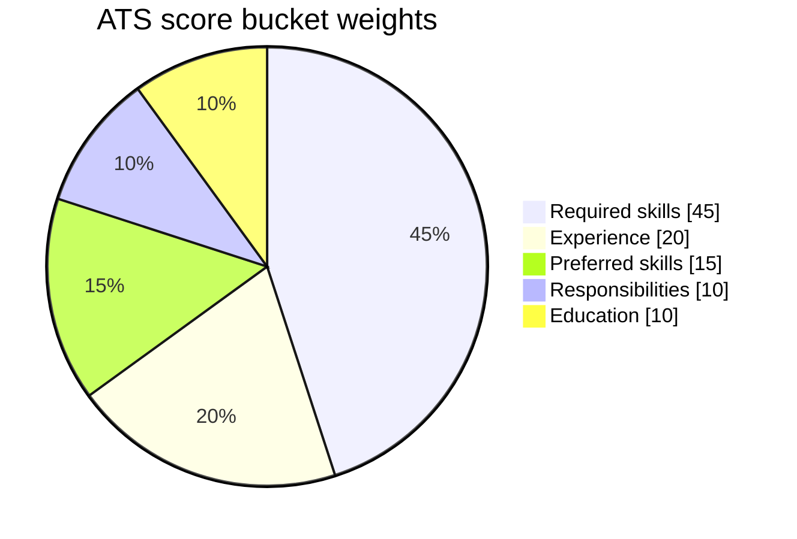
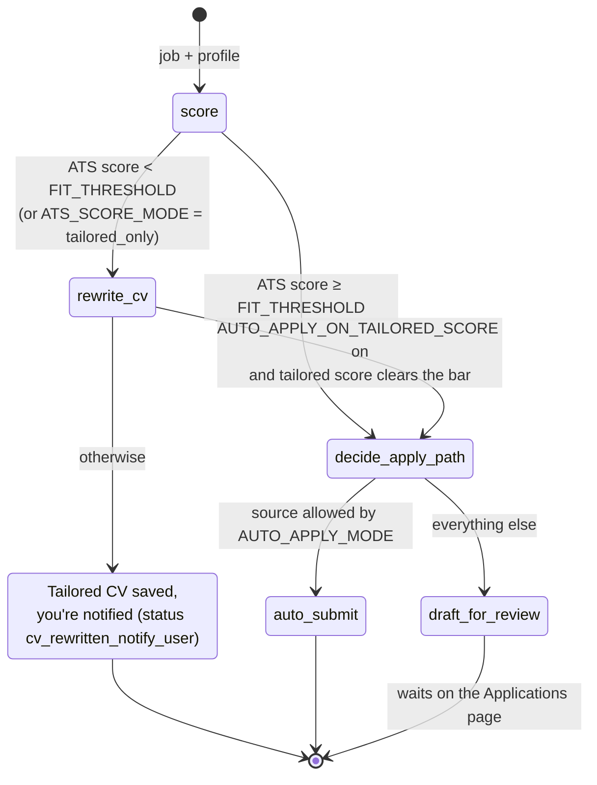
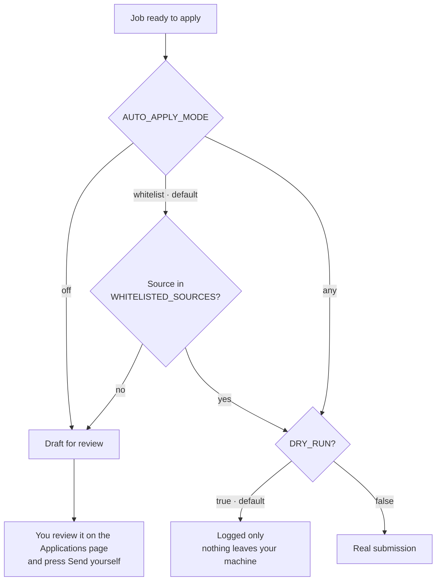

# How Sa'ei works

The pipeline, the scores and the dashboard, with diagrams. For setup see
[setup.md](setup.md); for a file-by-file deep dive see
[architecture.md](architecture.md).

## At a glance



A day in the life (all times are local, from `scheduler.py`):



---

## Core concepts

### 1. Your profile is the single record of you

Uploading a CV extracts a structured profile (contact, summary, experience,
projects, education, certifications, skills). **Every stage reads the
profile, not the file**, so a correction you make on the Profile page
reaches search, ranking, scoring and tailoring the next time they run.



> ⚠️ Uploading a new CV **replaces** the profile, including your hand edits.
> To pick up changes from the file without losing edits, use
> **Profile → Re-extract from CV**, which previews what would change first.

### 2. Finding jobs: search wide, then rank carefully

Job boards describe the same role in a dozen different ways, so finding jobs
is split into two stages tuned in opposite directions. **Retrieval** favours
recall (don't miss anything plausible). **Ranking** favours precision (put
the best fits first).



The **semantic path** is what catches a "Backend Developer" posting during a
"Software Engineer" search when the content genuinely fits you. Only jobs the
title filter rejects are embedded; a job it already accepted isn't paid for
twice.

**The match score** answers *"is this job right for me?"*. It's a weighted
sum of eight factors. Ranking deliberately uses no LLM, so ordinary search
volume never uses up a free-tier quota.



When a posting doesn't state something (salary and location often aren't
listed), that factor scores **neutral, not zero**. A job isn't penalised for
how its source happens to format postings.

### 3. The ATS score: requirement by requirement, fully explained

The ATS score answers a different question: *"would my CV get through this
employer's screening?"* Rather than counting keywords, the ATS agent
(`agents/ats_agent.py`):

1. extracts every requirement from the posting (one LLM call),
2. matches each requirement against your profile in up to three layers,
   stopping as soon as one layer decides,
3. computes the final score **in Python** from a credit table. No number a
   model returns ever reaches the score.



How the final number is weighted (`config.JOB_MATCH_WEIGHTS`):



Buckets a posting doesn't mention (no education line, say) are left out, and
their weight is spread over the rest. Inside a bucket, a *required* skill is
worth more points than a *preferred* one. Separately, a **parse-compatibility
check** (headers, length, bullet consistency, sections) grades the CV
*document* Pass / Warning / Fail, since that's a property of the file, not of
any one job.

Every **Why?** button in the dashboard opens this breakdown: each
requirement, how it matched (exact / alias / prerequisite / semantic / not
found), the points it earned, and the CV line that proves it. It's built from
the scoring pass itself, so explaining a score costs no extra LLM call.

Details: [matching.md](matching.md) (the matcher) and
[scoring.md](scoring.md) (the scoring pipeline, with a worked example).

### 4. What happens to each job

Every job that passes the match gate goes through a small LangGraph state
machine (`orchestrator.py`):



The tailored CV is scored again against the same requirements, which costs
one extra call rather than two. You see both numbers side by side. A tailored
CV never goes out scoring lower than your own: lines the rewrite weakened are
put back, and if it still can't beat your CV, your CV is used as it is
(`agents/tailoring.py`).

### 5. Who is allowed to press "send"



---

## The dashboard

`frontend/` is a static site, served by the API itself at `/`. It talks to
the FastAPI backend in `api.py`.

| Page | What it's for |
|---|---|
| **Home** | Greeting, the five-stage trajectory (Search → Match → Tailor → Apply → Grow), headline numbers, recent applications, and the skill gap Sa'ei noticed most |
| **Search** | Role, experience level and freshness; the job boards to scan (*Manage sources*); *Search* runs the pipeline now; the best recent matches |
| **Applications** | Every role found, with its match and ATS scores, and a detail panel with the reasons — and **Send application**, which emails it from your Gmail |
| **CV** | Your CV, every tailored version with its before → after score, and **Test against a job**: paste a posting to see your score and a tailored CV without saving anything |
| **Profile** | The extracted profile every agent reads, in sections that open one at a time; reorder them (tailored CVs follow the order) or add your own |
| **Reports** | One column, read top to bottom: the headline numbers as a sentence, the skills that would open the most doors, where your roles come from, this week's news, and everything Sa'ei sent |
| **Settings** | Opened from your name at the bottom of the sidebar: AI model, autonomy, matching thresholds, email & reports, and help |

Styling uses Tailwind, shipped **pre-compiled** as `frontend/tailwind.css`,
and fonts are stored in the repo, so the dashboard needs no CDN and no build
step. The dashboard is desktop-only (minimum width 1100px).

---

## Project layout

```
config.py / .env        settings (the Settings page writes .env via env_store.py)
models.py / db.py       SQLite schema and sessions
cv_parser.py            PDF/DOCX → text and links
profile_store.py        the stored profile every stage reads
orchestrator.py         LangGraph state machine for one job
scheduler.py            08:00 search · 20:00 report · Monday 09:00 news
api.py                  FastAPI backend, also serves the dashboard
agents/                 search, ranking, ATS scoring, CV tailoring, applying,
                        email, reports, news, and the matcher's internals
services/               embedding cache and per-CV semantic index
jobs/                   entry points: daily_run, daily_report, weekly_news, apply_from_link
frontend/               the dashboard (7 pages + shell.js, ui.js, config.js)
bench/                  labelled matching cases, precision/recall and calibration
tests/                  pytest suite
deploy/gcp/             server setup scripts (see deployment.md)
docs/                   these guides
```
